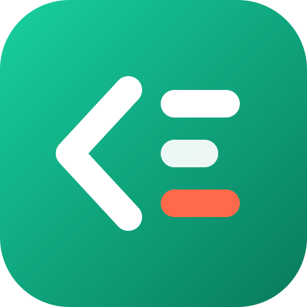

<div align="center">



# سَطر — برمج مشاكل حيّك

**منصة تحديات برمجية عربية من واقع الحياة في الجزائر.**
اقرأ حكاية من الواقع (حافلة، سوق، مدرسة، كشافة…)، اكتب الحل بـ JavaScript، وشاهد النتيجة فورًا.
 
`Next.js 14` · `React 18` · `TypeScript` · `Supabase` (اختياري)

</div>

---

## الوضع الحالي (بصراحة)

| الميزة | الحالة |
|---|---|
| تصفّح 20 تحدّيًا مع بحث عربي ومرشحات | ✅ يعمل |
| صفحة لكل تحدٍّ: قصة، مطلوب، أمثلة، تلميحات (3 مستويات) | ✅ يعمل |
| تشغيل الأمثلة الظاهرة في **بيئة معزولة** داخل المتصفح (بلا شبكة، بمهلة 3 ثوانٍ) | ✅ يعمل |
| حفظ تلقائي للمسودة وتذكّر ما حللته (على جهازك) | ✅ يعمل |
| تسجيل الدخول برابط سحري (Supabase) | ⚙️ يعمل عند ضبط المتغيرات |
| لوحة «تقدّمي»: مهام وجواهر وسلسلة ومراجعة | 🧪 تجريبية محلية (ليست سجلًّا رسميًا) |
| **تصحيح رسمي** بالاختبارات المخفية على الخادم، والنقاط الحقيقية | ⏳ لم يُبنَ بعد |
| دوري الأسبوع وغرف الأصدقاء | ⏳ مخطَّط (انظر `docs/MASTER_SPEC.md`) |

> المتصفح لا يستلم **إلا الاختبارات الظاهرة**. الاختبارات المخفية والحل المرجعي تبقى على الخادم.

## تشغيل المشروع

المتطلبات: **Node.js 18.17 أو أحدث** (يُنصح بـ 20؛ يوجد ملف `.nvmrc`).

```bash
npm install
cp .env.example .env.local     # اختياري: يعمل الموقع بدونه (بلا تسجيل دخول)
npm run dev                    # ثم افتح http://localhost:3000
```

## الأوامر

| الأمر | الوظيفة |
|---|---|
| `npm run dev` | تشغيل محلي للتطوير |
| `npm run build` / `npm start` | بناء وتشغيل نسخة الإنتاج |
| `npm run check` | **كل الفحوصات**: المحتوى + الاختبارات + الأنواع + ESLint |
| `npm test` | اختبارات المنطق والأمان والمنفّذ |
| `npm run validate:content` | التحقق من ملفات التحديات |
| `npm run typecheck` / `npm run lint` | فحص الأنواع / الأسلوب |

## بنية المشروع

```
app/                  صفحات Next.js وواجهات API
  page.tsx            الرئيسية
  challenges/         مكتبة التحديات + صفحة كل تحدٍّ ([slug])
  progress/           لوحة تقدّمي (تجريبية)
  runner/route.ts     صفحة المنفّذ المعزول (تُضمَّن في iframe)
  api/                واجهات الخادم (مهام، سلسلة، مراجعة، تحليلات…)
  icon.svg · manifest.ts · not-found.tsx · error.tsx
components/           مكوّنات الواجهة (SiteShell، ChallengeWorkspace، …)
lib/                  المنطق: brand، challenges (خادم)، runner، security
styles/               CSS Modules (site + workspace)
content/              challenges.json · tracks.json  ← مصدر المحتوى
supabase/migrations/  هجرات قاعدة البيانات (0001–0007)
scripts/              validate-challenges.mjs
tests/                اختبارات node:test
docs/                 الوثائق (ابدأ من docs/README.md)
middleware.ts         ترويسات الأمان (CSP…)
```

## المتغيرات

| المتغير | مطلوب؟ | ملاحظة |
|---|---|---|
| `NEXT_PUBLIC_SITE_URL` | موصى به | عنوان الموقع |
| `NEXT_PUBLIC_SUPABASE_URL`، `NEXT_PUBLIC_SUPABASE_ANON_KEY` | للدخول فقط | من Supabase ← Settings ← API |
| `SUPABASE_SERVICE_ROLE_KEY` | لواجهات `/api` | **سرّي: للخادم فقط** |
| `CRON_SECRET`، `ADMIN_EMAIL` | للمهام والإدارة | انظر `docs/DEPLOYMENT.md` |

## إضافة تحدٍّ جديد

1. أضف كائنًا إلى `content/challenges.json` بنفس بنية الموجود (`slug`، `title`، `topic`، `level`، `functionName`، `starter`، `tests` …).
2. اجعل لكل تحدٍّ **6 اختبارات على الأقل** (اثنان ظاهران والباقي مخفية) وثلاثة تلميحات وشرحًا وحلًّا مرجعيًا.
3. شغّل `npm run validate:content` ثم `npm test`.
4. تظهر الصفحة تلقائيًا في `/challenges/<slug>`، ولا حاجة لتعديل أي كود.

## الأمان باختصار

- **كود المستخدم** يعمل داخل `iframe` بخاصية `sandbox` على `/runner` بسياسة CSP تمنع الشبكة تمامًا، وفي Worker يُنهى عند المهلة.
- **بقية الموقع**: CSP صارمة (بلا `unsafe-eval` في الإنتاج)، ولا تُضمَّن الصفحات في إطارات، و`connect-src` محصور بموقعك وSupabase.
- **ما لا يضمنه المتصفح**: حدّ الذاكرة، ولا منع الغش. لذلك أي نقاط رسمية يجب أن تُحسب على الخادم (`docs/ARCHITECTURE.md`).

## الوثائق

- [`docs/README.md`](docs/README.md) — فهرس الوثائق
- [`docs/ARCHITECTURE.md`](docs/ARCHITECTURE.md) — البنية وقرارات التصميم
- [`docs/DEPLOYMENT.md`](docs/DEPLOYMENT.md) — النشر على Vercel وSupabase
- [`docs/MASTER_SPEC.md`](docs/MASTER_SPEC.md) — المواصفات الكاملة للمنتج
- [`CHANGELOG.md`](CHANGELOG.md) — سجل التغييرات
